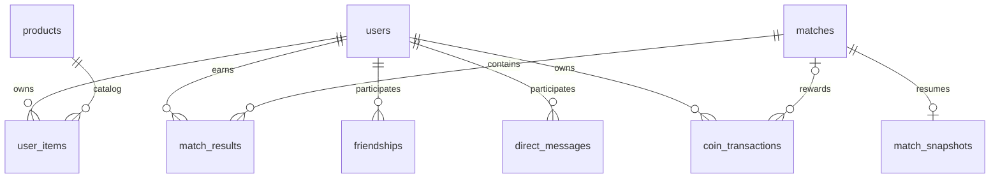

# Lưu trữ cửa hàng và trận đấu

Kết quả mới nhất của đợt chuẩn bị demo nằm ở [cuối tài liệu](#kết-quả-vừa-chạy--đợt-chuẩn-bị-demo-27102026); các bảng mang nhãn **cũ** bên dưới được giữ để phân biệt lịch sử kiểm thử.

Server mặc định dùng MySQL. Chạy `MigrateMain` riêng để nâng cấp cộng thêm qua `GameSchema`; server thông thường không chạy DDL. Không cần xoá volume Docker hay tạo lại database. `docker/mysql/init.sql` cung cấp cùng cấu trúc cho cài đặt mới.

## Quan hệ



- `products`: mã, tên, mô tả, giá, loại (`THEME`/`TITLE`), màu, trạng thái bán và thứ tự hiển thị. Sáu sản phẩm hiện có được thêm nếu thiếu; khởi động lại không ghi đè giá/tên do quản trị viên sửa. Vật phẩm cũ không có trong danh mục được giữ dưới loại `LEGACY`, không bán. Các hiệu ứng hình ảnh vẫn do client hỗ trợ theo mã vật phẩm; thêm mã mới không tự tạo hiệu ứng mới.
- `user_items`: giữ quan hệ người dùng–vật phẩm và thời gian mua. Thêm khóa ngoại tới `products`; vật phẩm đã có người sở hữu nên được ẩn bằng `active=FALSE` thay vì xoá.
- `matches`: UUID mới cho mỗi lần bắt đầu, mã phòng, kích thước bàn, chủ đề, số người, thời gian bắt đầu/kết thúc (epoch milliseconds), trạng thái, lý do và cờ kết thúc bất thường.
- `match_results`: khoá chính `(match_id, username)`, điểm/cặp, thứ hạng, bỏ cuộc, thắng, số trận thắng được cộng, xu thưởng, thay đổi điểm và nội dung lịch sử. `rating_delta` là mức theo luật; `rating_applied` là mức thực tế sau giới hạn điểm không dưới 0.

## Dữ liệu cũ

`match_history` được giữ nguyên làm nguồn lưu trữ cũ. Nâng cấp chép từng dòng sang mã `legacy-<id>` với trạng thái `LEGACY`, giữ nguyên nội dung và thứ tự. Không thể khôi phục mã trận, đối thủ, bàn hoặc chủ đề từ chuỗi lịch sử cũ một cách chắc chắn, nên mỗi dòng cũ được lưu độc lập; các trường cấu trúc chưa biết là NULL. Trận đã lưu ở phiên bản trước nhưng thiếu chủ đề được đánh dấu `UNKNOWN`, không đoán hình ảnh đã dùng. Quá trình nhập không cộng lại thưởng hoặc thống kê. Chạy nâng cấp lại không tạo bản sao trùng.

Nếu nhập tài khoản còn thiếu từ `data/state.bin`, tài khoản, vật phẩm và lịch sử được ghi trong cùng transaction. Luồng file dành cho kiểm thử vẫn hoạt động; các bảng database áp dụng cho chế độ MySQL.

## Transaction và đồng bộ

Mua hàng khoá hàng tài khoản và đọc giá hiện tại của sản phẩm trong transaction. Trừ xu và thêm quyền sở hữu cùng commit; yêu cầu mua lặp lại không trừ xu lần nữa. Số dư trong database là nguồn quyết định giao dịch.

Khi bắt đầu trận, server ghi `matches` trạng thái `PLAYING` và danh sách người tham gia (kết quả chưa có, các chỉ số NULL) trong một transaction trước khi phát `GAME_START`. Mỗi lượt chơi lại tạo UUID riêng. Nếu lưu thất bại, trận chưa bắt đầu.

Khi kết thúc, server giữ nguyên thuật toán xếp hạng/thưởng cũ và transaction khoá mã trận, ghi toàn bộ kết quả, cập nhật thống kê/ví của người chơi, rồi chuyển sang `COMPLETED`. Yêu cầu lưu lại mã trận đã hoàn thành không thưởng thêm. Client chỉ nhận kết quả và ví sau khi ghi thành công. Lỗi lưu tạm thời được thử lại sau 3 giây khi server vẫn chạy.

Trong chế độ MySQL, `saveState()` không ghi snapshot RAM. Đăng ký/nhập tài khoản chỉ chèn tài khoản chưa có; đổi mật khẩu, avatar và trang bị cập nhật đúng trường của đúng tài khoản. Mật khẩu dùng điều kiện hash cũ; trang bị kiểm tra quyền sở hữu trong database. Snapshot cũ không thể ghi đè ví, thống kê, mật khẩu, avatar, trang bị hoặc khôi phục vật phẩm đã bị thu hồi. Cập nhật giao diện lấy lại số liệu đã commit. Lịch sử đọc từ `matches JOIN match_results` và đọc thêm trực tiếp `match_history` cho các dòng chưa được chuyển đổi, loại trùng theo `legacy_history_id`, tối đa 50 kết quả mới nhất. Trường `recorded_at` và chỉ mục `(username, recorded_at DESC, match_id)` phục vụ lịch sử theo người và thời gian; bảng cũ giữ chỉ mục `(username, played_at DESC)`.

Ván đang chơi được lưu trong `match_snapshots` (phiên bản, checksum SHA-256, revision tăng đơn điệu và thời gian ghi). Snapshot giữ bàn bí mật, thẻ đã lật/ghép, chủ cặp, điểm, người bỏ cuộc, chat, giai đoạn xử lý và thời gian còn lại. Cập nhật snapshot dùng điều kiện revision trước đó; bản ghi cũ bị từ chối thay vì ghi đè. Server ghi trước khi công bố thao tác đã nhận, ghi định kỳ mỗi giây để cập nhật đồng hồ và ghi khi dừng bình thường. Thời gian server ngừng chạy không trừ vào lượt. Chế độ lưu file không hỗ trợ khôi phục ván.

Khi khởi động, server kiểm tra snapshot rồi phục hồi ván ở trạng thái tạm dừng. Người chơi đăng nhập lại để thấy bàn cũ; tất cả người còn tham gia phải bấm **Xác nhận tiếp tục**. Thời hạn chờ là **120 giây**, lưu trong snapshot theo thời điểm tuyệt đối, không gia hạn khi restart tiếp. Trong lúc chờ không được lật thẻ/chat. Hết hạn, người chưa online hoặc chưa xác nhận được tính bỏ cuộc cùng lúc; không chọn nhầm người vắng mặt cuối cùng làm người thắng. Còn từ hai người đã xác nhận thì tiếp tục; còn một người thì xử theo luật thắng do bỏ cuộc; không còn ai thì không có người thắng (vẫn dùng luật thưởng thua hiện có). Có thể chủ động rời phòng. Các pha đang chờ úp cặp sai hoặc chờ lượt mới tiếp tục với thời gian còn lại. Thẻ úp luôn bị che trong thông điệp gửi client.

Snapshot thiếu, hỏng hoặc không hợp lệ khiến ván chuyển `INTERRUPTED`, không thưởng. Ván hoàn tất xoá snapshot trong cùng transaction ghi kết quả; mã trận chống cộng thưởng lặp lại. Ván đang tính kết quả được xử lý tiếp sau khi khởi động. Lỗi ghi snapshot khiến ván quay về trạng thái đã lưu gần nhất và tạm dừng. MySQL named lock chặn hai server mới chạy đồng thời trên cùng database; vẫn phải dừng server phiên bản cũ trước khi nâng cấp.

## Ràng buộc dữ liệu

- PK: `products(product_id)`, `matches(match_id)`, `match_results(match_id, username)`, `user_items(username, product_id)`. Mỗi người chỉ có một kết quả mỗi trận và một quyền sở hữu mỗi vật phẩm.
- FK: `user_items → users/products`, `match_results → matches/users`. Không xoá sản phẩm đã có người sở hữu; dùng `active=FALSE`. Người đã sở hữu vẫn nhìn thấy và trang bị được vật phẩm ngừng bán.
- CHECK: giá, xu, rating, thống kê và số cặp không âm; thứ hạng 1–4; cờ boolean chỉ 0/1; bàn 4/6/8, số người 2–4; trạng thái trận chỉ `PLAYING/COMPLETED/INTERRUPTED/LEGACY`; thời gian kết thúc không trước bắt đầu và trận đã kết thúc phải có lý do. Các chỉ số chưa biết của lịch sử cũ/trận bị tắt đột ngột có thể NULL.
- Migration thêm cột/chỉ mục/CHECK còn thiếu và backfill thời gian từ `matches`. Nếu dữ liệu cũ vi phạm CHECK, nâng cấp báo lỗi cụ thể; không tự xoá hoặc ép số âm về 0. DDL MySQL có thể đã áp dụng một phần; chạy lại an toàn sau khi sửa dữ liệu không hợp lệ.

## Áp dụng

1. Kết thúc các trận hiện tại và dừng server cũ.
2. Cấu hình `MYSQL_ROOT_PASSWORD` và `MEMORY_GAME_DB_PASSWORD` trước khi chạy Docker Compose. Đây là mật khẩu do bạn chọn cho cài đặt mới; với volume cũ, dùng mật khẩu đang có (đổi biến môi trường không đổi mật khẩu trong MySQL). Java đọc biến môi trường của tiến trình, không tự đọc `.env` của Compose.
3. Đặt `MEMORY_GAME_DB_URL` (mặc định database `memory_game` tại `localhost:3307`), `MEMORY_GAME_DB_USER` và `MEMORY_GAME_DB_PASSWORD` cho tài khoản migration. Chạy `sh migrate-database.sh` trên macOS/Linux hoặc `migrate-database.bat` trên Windows. JDBC driver phải có trong `lib/`; `setup-database.bat` tải driver trên Windows.
4. Chuyển biến môi trường sang tài khoản chạy game có quyền `SELECT, INSERT, UPDATE, DELETE` trên database; bỏ `MEMORY_GAME_DB_MIGRATE` hoặc đặt `false`, rồi khởi động server bằng `sh run-server.sh` hoặc `run-server.bat`. Các script này ép `MEMORY_GAME_DB_MIGRATE=false`, không tự chạy Docker Compose; MySQL phải đang hoạt động. Tài khoản migration cần quyền tạo/sửa bảng, chỉ mục, view và dữ liệu. Tài khoản `memory_game` do image MySQL tạo mặc định có toàn quyền trên database; muốn tách quyền, quản trị viên cần cấp một tài khoản runtime riêng. `MEMORY_GAME_DB_MIGRATE=true` chỉ dùng khi chủ động muốn chạy migration lúc khởi động.
5. Làm mới Schemas để thấy `friendships`, `direct_messages`, `coin_transactions`, `match_snapshots`. SQL nâng cấp schema nằm tại `docker/mysql/migrations/20261027-persistence.sql` và `20261027-passwords.sql` (chạy theo thứ tự này); sau đó chạy `MigrateMain` để chuyển và xóa bảng tin nhắn SQL cũ nếu còn. Cài mới và khởi động server không tạo lại bảng cũ. Phần nhập tệp được thực hiện bởi server sau khi nhập tài khoản.

Mật khẩu tài khoản game mới dùng PBKDF2-HMAC-SHA256, 600.000 vòng, salt ngẫu nhiên riêng. Hash SHA-256 cũ được giữ tới lần đăng nhập đúng mật khẩu, rồi nâng cấp và lưu thành công trước khi xác nhận đăng nhập. Cột `password_hash` được mở rộng lên `VARCHAR(255)` để chứa định dạng mới.

Không chạy đồng thời server cũ với server mới trên cùng database: server cũ vẫn viết lại bảng lịch sử cũ. Nâng cấp đã được kiểm tra trên database tạm riêng; dữ liệu đang dùng không bị chỉnh trực tiếp trong quá trình kiểm thử.

## Kiểm thử

Biên dịch các kiểm thử:

```sh
sh compile.sh
javac -encoding UTF-8 -cp 'out:lib/*' -d out test/*.java
```

Khi Docker MySQL dự án đang chạy:

Đặt `MEMORY_GAME_TEST_DB_PASSWORD` bằng mật khẩu root của MySQL kiểm thử tại `127.0.0.1:3307`. Harness tạo và xóa schema ngẫu nhiên riêng cho mỗi ca. Chạy `sh run-database-tests.sh` cho các ca database chính; có thể truyền tên class đầy đủ để chọn ca. Benchmark lớn chạy riêng bằng `sh run-database-tests.sh memorygame.server.DatabasePerformanceTest`.

```sh
java -Djava.awt.headless=true -cp 'out:lib/mysql-connector-j-26.7.0.jar' memorygame.test.DatabaseFlowsTest
java -Djava.awt.headless=true -cp 'out:lib/mysql-connector-j-26.7.0.jar' memorygame.test.DatabaseFlowsTest memorygame.server.GameSchemaInitTest
java -Djava.awt.headless=true -cp 'out:lib/mysql-connector-j-26.7.0.jar' memorygame.test.DatabaseFlowsTest memorygame.test.GamePersistenceProtocolTest
```

Kiểm tra thêm bản schema trung gian và dừng server:

```sh
java -Djava.awt.headless=true -cp 'out:lib/mysql-connector-j-26.7.0.jar' memorygame.test.DatabaseFlowsTest memorygame.server.PreviousGameSchemaTest
java -Djava.awt.headless=true -cp 'out:lib/mysql-connector-j-26.7.0.jar' memorygame.test.DatabaseFlowsTest memorygame.test.ServerInterruptionTest
```

Mỗi lệnh dùng database có tên ngẫu nhiên `game_test_*`, rồi xoá chính database tạm đó. Kiểm tra gồm nâng cấp lặp lại, bảo toàn dữ liệu cũ, SQL cài mới, danh mục động, mua đồng thời, thiếu xu/vật phẩm ẩn, rollback khi chèn lỗi, bắt đầu trận lỗi, chống thưởng trùng kể cả sau khởi động lại, trận hoàn chỉnh, chơi lại, bỏ cuộc, lịch sử và khóa ngoại.

Kiểm thử phục hồi qua nhiều lần khởi động lại (thẻ đầu, cặp sai, cặp đúng, chat, xác nhận, che thẻ, hoàn tất và thưởng):

```sh
java -Djava.awt.headless=true -cp 'out:lib/mysql-connector-j-26.7.0.jar' memorygame.test.DatabaseFlowsTest memorygame.test.GameRecoveryTest
```

Kiểm thử tắt cưỡng bức tiến trình riêng trong phòng ghép nhanh, khoá server trùng và snapshot hỏng:

```sh
java -Djava.awt.headless=true -cp 'out:lib/mysql-connector-j-26.7.0.jar' memorygame.test.DatabaseFlowsTest memorygame.test.GameCrashRecoveryTest
```

## Bổ sung lưu trữ bền vững 27/10/2026

- `friendships`: người gửi/nhận, request UUID, trạng thái PENDING/ACCEPTED/DECLINED/EXPIRED, thời gian. Cặp chuẩn hóa bằng LEAST/GREATEST có UNIQUE, CHECK cấm tự kết bạn, FK về users. Lời mời PENDING không tự hết hạn; giữ nguyên khi offline, đăng xuất hoặc server khởi động lại cho đến khi người nhận chấp nhận/từ chối. Trạng thái EXPIRED có từ trước vẫn là trạng thái kết thúc và không được khôi phục. Phản hồi lặp cùng lựa chọn là idempotent. File bạn bè cũ không có timestamp nên `created_at=NULL`, không giả thời gian tạo quan hệ.
- `direct_messages`: bảng duy nhất cho tin nhắn riêng, FK hai người tham gia, nội dung, sent_at/read_at, khóa `legacy_key` và index theo hai chiều. Phân trang keyset 50 tin, khóa danh tính bằng phiên đăng nhập; trường sender do client tự gửi không cấp thêm quyền. Client chỉ gửi dấu đã đọc sau khi nhận trang đang hiển thị hoặc nhận tin trong cửa sổ có focus. Không cho người thứ ba đọc lịch sử hoặc đánh dấu tin của người khác.
- Khi nâng cấp, `MigrateMain` chuyển từng dòng SQL cũ sang `direct_messages` với `private_messages:<id>`, kiểm tra dữ liệu và xung đột trước khi xóa bảng cũ. Việc sao chép commit và đối chiếu đầy đủ trước lệnh `DROP TABLE` riêng; nếu kiểm tra/copy lỗi, nguồn được giữ lại để sửa và chạy lại. Không chạy migration đồng thời với server phiên bản cũ đang ghi bảng nguồn. Tệp server `private-messages.bin` vẫn được nhập riêng bằng khóa hash cùng số lần xuất hiện để giữ tin giống hệt nhau; tệp nguồn không bị xóa. Không tự đưa cache client lên server.
- `coin_transactions`: khóa `purchase:<user>:<product>` cho vật phẩm mua một lần và `reward:<match>:<user>` cho thưởng. Chèn sổ, cập nhật số dư/quyền sở hữu/kết quả và xóa snapshot cùng transaction. Số dư cũ giữ nguyên; không tạo dòng mở sổ hay thưởng lại trận cũ. Sau lỗi giao dịch chưa biết kết quả commit, cache thống kê không được công bố cho tới khi đọc lại database thành công.
- Snapshot chứa trạng thái server; giá trị thẻ úp vẫn trả `-1` trong giao thức. SETTLING được xử lý tiếp ngay khi khởi động. Thẻ đầu, cặp sai đang chờ úp và cặp đúng đang chờ chuyển lượt giữ thời gian còn lại. Giữ các luật điểm, thưởng 50/10 và giới hạn lượt hiện có.

## Kết quả cũ — trước đợt chuẩn bị demo

Chạy trên Java 17 và MySQL Docker hiện có, mỗi ca database dùng schema tạm riêng (không migration trực tiếp database người dùng):

| Ca đã chạy | Kết quả |
|---|---|
| `GameDatabaseTest` | Đạt: nâng cấp dữ liệu cũ, mua đồng thời, rollback, thưởng trùng |
| `PersistenceExtensionsTest` | Đạt: nguồn bạn bè/chat có thật; nhập lặp; SQL migration chạy hai lần; database đã có một phần tài khoản; phân trang, quyền riêng tư, đã đọc; lỗi ghi sổ; snapshot CAS |
| `GameSchemaInitTest`, `PreviousGameSchemaTest` | Đạt: SQL cài mới và schema cũ giữ số dư/kết quả/vật phẩm |
| `SocialTest` (MySQL) | Đạt: chấp nhận/từ chối, giả phản hồi, gửi lại yêu cầu, chống tự kết bạn, giữ quan hệ sau restart |
| `WhisperSyncTest` (MySQL) | Đạt: 103 tin, client mới sau restart, phân trang giao thức và chặn người thứ ba |
| `GameRecoveryTest` | Đạt: thẻ đầu/cặp sai/cặp đúng/chat, che thẻ, xác nhận và hoàn tất |
| `GameCrashRecoveryTest` | Đạt: kill cưỡng bức tiến trình, giữ thẻ đã xác nhận, khóa server thứ hai, từ chối snapshot hỏng |
| `RecoveryWaitTest` | Đạt: chờ thật đủ 120 giây, restart không gia hạn, người vắng bị tính bỏ cuộc, thưởng và xóa snapshot |
| `SnapshotFailureTest` | Đạt: trigger gây lỗi ghi thẻ và kết quả, rollback RAM, khởi động lại trong SETTLING |
| `RoomSettingsTest`, `ServerInterruptionTest` (MySQL) | Đạt: mất kết nối/kết nối lại, giữ người đã bỏ cuộc, dừng lặp và chỉ gián đoạn trận thiếu snapshot |
| `GamePersistenceProtocolTest` | Đạt: chơi trọn ván, chơi lại, bỏ cuộc, mua đồ và lịch sử |
| `TestSuite` (file, headless) | Chưa đạt toàn bộ: dừng ở `ShopEffectsTest`, `theme_classic changedPixels=0`. Đã tái hiện cùng lỗi trên bản HEAD gốc trong thư mục tạm. Các ca trước đó, gồm reconnect trong `RoomSettingsTest`, đã đạt. |

Lệnh bổ sung (sau `sh compile.sh` và `javac -encoding UTF-8 -cp 'out:lib/*' -d out test/*.java`):

```sh
java -Djava.awt.headless=true -cp 'out:lib/*' memorygame.test.DatabaseFlowsTest memorygame.server.PersistenceExtensionsTest
java -Djava.awt.headless=true -cp 'out:lib/*' memorygame.test.DatabaseFlowsTest memorygame.test.SnapshotFailureTest
java -Djava.awt.headless=true -cp 'out:lib/*' memorygame.test.DatabaseFlowsTest memorygame.test.RecoveryWaitTest
```

## Kiểm chứng cũ bổ sung ngày 27/10/2026

- `PasswordHashesTest`, `PasswordMigrationTest`: đạt kiểm tra salt ngẫu nhiên, Unicode, hash lỗi, mật khẩu cũ, lỗi lưu khi nâng cấp, giữ số dư, đổi mật khẩu và đăng nhập sau restart.
- `RuntimePrivilegesTest`: đạt chạy luồng hồ sơ bằng tài khoản chỉ có SELECT/INSERT/UPDATE/DELETE; ALTER TABLE bị từ chối. Tài khoản kiểm thử được xóa sau khi chạy.
- `SchemaParityTest`: đạt so sánh cột, chỉ mục, khóa ngoại, CHECK giữa SQL cài mới và migration Java, chạy lại migration SQL ba lần.
- `CommitDisconnectTest`: đạt khi proxy TCP cắt năm gói phản hồi COMMIT; kiểm tra mua hàng, bắt đầu trận, snapshot, kết quả và đối chiếu lại trận khi kết nối mới cũng lỗi. Không ghi nợ/thưởng trùng.
- `CrashPhasesTest`: đạt kill cưỡng bức JVM ở thẻ đầu, cặp sai, chuyển lượt và SETTLING; phục hồi bàn, điểm, người chơi, thời gian và thưởng đúng một lần.
- `DatabasePerformanceTest`: Java 17.0.18, MySQL 8.4.11, macOS arm64; dữ liệu tạm gồm 10.000 tài khoản, 200.000 tin nhắn, 50.000 trận và 100.000 kết quả. Với 15 mẫu, chat đạt median/p95 2,636/3,824 ms; lịch sử 3,008/3,507 ms. Đây là benchmark cục bộ, không phải cam kết tải đồng thời.
- `TestSuite` chế độ file đã chạy đến cuối: còn lỗi `ShopEffectsTest` (hiệu ứng không đổi pixel) và `StreamingMusicTest` (thời lượng WAV không khớp 3.638 giây). Các ca còn lại đạt. Hai lỗi giao diện/tài nguyên này chưa được sửa trong phạm vi MySQL.

Giới hạn: client mới được mô phỏng bằng socket độc lập trên cùng máy, chưa thử hai máy vật lý. Đã thử mất phản hồi COMMIT bằng proxy, kill tiến trình game và lỗi SQL bằng trigger; chưa thử mất điện máy chủ/MySQL. Chưa kiểm tra thủ công cửa sổ Swing trên desktop. Chế độ file vẫn dành cho kiểm thử, không hỗ trợ phục hồi trận. Không bổ sung chức năng sao lưu database.


## Quy trình cài mới/nâng cấp cho demo

Cài mới: cấu hình mật khẩu Docker → chạy MySQL và chờ healthy → tải JDBC vào `lib/` → biên dịch/migration bằng tài khoản migration → chuyển sang tài khoản runtime → khởi động server → khởi động client cùng bản mã nguồn. Windows dùng `setup-database.bat`, `migrate-database.bat`, `run-server.bat`, `run-client.bat` theo thứ tự. macOS/Linux dùng `docker compose up -d mysql adminer`, `sh migrate-database.sh`, `sh run-server.sh`, `sh run-client.command`. JDBC 26.7.0 có thể lấy từ đường dẫn Maven Central trong `setup-database.bat`; Java 17 là yêu cầu chung.

Ví dụ biến môi trường trên macOS/Linux (thay giá trị trong dấu `<…>`; không lưu mật khẩu thật vào Git):

```sh
export MYSQL_ROOT_PASSWORD='<mật khẩu root Docker>'
export MEMORY_GAME_DB_PASSWORD='<mật khẩu memory_game của Docker>'
docker compose up -d mysql adminer
# Chờ mysql healthy trước bước sau.
export MEMORY_GAME_DB_URL='jdbc:mysql://127.0.0.1:3307/memory_game?useSSL=false&allowPublicKeyRetrieval=true&serverTimezone=UTC'
export MEMORY_GAME_DB_USER='<tài khoản migration>'
export MEMORY_GAME_DB_PASSWORD='<mật khẩu migration>'
sh migrate-database.sh
export MEMORY_GAME_DB_USER='memory_game_runtime'
export MEMORY_GAME_DB_PASSWORD='<mật khẩu runtime>'
sh run-server.sh 12345 --headless
```

Trong Windows CMD, dùng `set TEN_BIEN=gia_tri` thay `export`; classpath dùng `;` thay `:`. Java không đọc `.env`; biến cần nằm trong đúng terminal chạy Java. Nếu dùng `.env` cho Docker Compose, giữ các giá trị Docker riêng, không thay bằng mật khẩu runtime. Không chạy lại Compose bằng môi trường migration/runtime. Nếu container đã được tạo và chỉ đang dừng, có thể dùng `docker start memory-game-mysql` rồi chờ healthy.

Quản trị viên có thể tạo tài khoản runtime riêng bằng SQL dưới đây sau migration (thay mật khẩu, chọn host phù hợp với kết nối từ máy chạy server):

```sql
CREATE USER 'memory_game_runtime'@'%' IDENTIFIED BY '<mật khẩu runtime riêng>';
GRANT SELECT, INSERT, UPDATE, DELETE ON memory_game.* TO 'memory_game_runtime'@'%';
```

Đây là lệnh cấp tài khoản một lần, không phải migration chạy lặp. Với tài khoản đã tồn tại, kiểm tra `SHOW GRANTS` và chỉ cấp quyền còn thiếu. Không cấp tài khoản runtime quyền CREATE/ALTER/DROP. Test quyền hạn tạo tài khoản ngẫu nhiên chỉ trên schema thử nghiệm và xóa tài khoản đó khi hoàn tất.

Nâng cấp: dừng server cũ sau khi hoàn tất ván → giữ nguyên volume và tệp dữ liệu cũ → dùng đúng URL/mật khẩu hiện có → chạy `MigrateMain` bằng tài khoản migration → đổi về runtime → chạy server mới. `MigrateMain` là lệnh chủ động duy nhất chuyển dữ liệu SQL cũ và chỉ xóa bảng nguồn sau khi sao chép đã commit, đối chiếu từng khóa/dữ liệu thành công; nếu source đã được xóa thì chạy lại an toàn. Không dùng `docker compose down -v`, không nạp `init.sql` vào database cũ. Các tệp SQL rời dành cho nâng cấp schema trung gian và không tạo bảng tin nhắn cũ. Thay đổi lần này không thêm bảng và không thay luật thưởng/lượt chơi.

Các thư mục `dist/` chứa bản đóng gói cũ; đợt này biên dịch và kiểm tra từ `src/` vào `out/`, không cập nhật các bản đóng gói đó. Khi demo hai máy, dùng cùng bản source hiện tại và biên dịch trên từng máy; không trộn client trong `dist/` với server mới.

Kịch bản thao tác và SQL đối chiếu: [demo-two-machines.md](demo-two-machines.md).


## Kết quả vừa chạy — đợt chuẩn bị demo 27/10/2026

Đây là kết quả thực hiện lại trong yêu cầu chuẩn bị demo, không suy ra từ các bảng cũ. Môi trường: macOS/Darwin arm64, OpenJDK Homebrew 17.0.18, MySQL Docker 8.4.11 trên `127.0.0.1:3307`, Connector/J 26.7.0, chế độ headless. Mỗi ca database dùng `game_test_<UUID>` mới và được dọn trong `finally`; không chạy migration, trigger gây lỗi, kill MySQL hoặc test phá hủy trên database đang dùng. Test crash chỉ kill JVM con do test tạo. Test quyền hạn tạo và xóa riêng tài khoản `game_rt_<ngẫu nhiên>`.

### Lệnh đã chạy

Mật khẩu test được lấy từ cấu hình container vào môi trường tiến trình, không in vào log. Các lệnh dưới đây tương ứng với hai đợt chạy bằng harness (đặt `MEMORY_GAME_TEST_DB_PASSWORD` trước):

```sh
sh run-database-tests.sh
sh run-database-tests.sh   memorygame.server.CommitDisconnectTest   memorygame.server.RuntimePrivilegesTest   memorygame.server.PreviousGameSchemaTest   memorygame.server.GameSchemaInitTest   memorygame.test.GameRecoveryTest   memorygame.test.GameCrashRecoveryTest   memorygame.test.SnapshotFailureTest   memorygame.test.RecoveryWaitTest   memorygame.test.ServerInterruptionTest

# Tái hiện hai lỗi trước sửa và xác nhận lại sau sửa:
java -Djava.awt.headless=true -cp out memorygame.test.ShopEffectsTest
java -Djava.awt.headless=true -cp out memorygame.client.StreamingMusicTest

# Hồi quy tổng sau sửa:
MEMORY_GAME_STORAGE=file java -Djava.awt.headless=true -cp out memorygame.test.TestSuite
```

### Kết quả thực tế

| Ca chạy lần này | Kết quả |
|---|---|
| `GameDatabaseTest`, `PersistenceExtensionsTest` | Đạt: nhập schema/tệp cũ, chạy lại không trùng, giữ số dư/lịch sử/vật phẩm, mua đồng thời, sổ xu, rollback và thưởng một lần |
| `PreviousGameSchemaTest`, `GameSchemaInitTest`, `SchemaParityTest` | Đạt: schema trung gian/cài mới, khóa ngoại/CHECK/chỉ mục và chạy migration lặp |
| `PasswordHashesTest`, `PasswordMigrationTest` | Đạt: salt/Unicode/hash lỗi, login SHA-256 cũ, lỗi ghi nâng cấp không xác nhận login, đổi mật khẩu và restart |
| `CommitDisconnectTest` bản mở rộng | Đạt: cắt **6** phản hồi COMMIT thật; mua, bắt đầu, snapshot, kết quả; từ chối kết nối trước mua; mất cả ACK và kết nối đối chiếu sau mua không báo thành công; retry không trừ/cấp trùng; trận chưa rõ kết quả tạo được đối chiếu lại |
| `RuntimePrivilegesTest` bản mở rộng | Đạt: ALTER bị từ chối; hồ sơ, kết bạn, chat và trọn ván/mua hàng đều chạy với SELECT/INSERT/UPDATE/DELETE, migration tắt |
| `WhisperSyncTest`, `SocialTest` (ca con của test quyền hạn) | Đạt: bạn bè sau restart, 103 tin, client mới, phân trang, Unicode và cách ly người thứ ba |
| `GamePersistenceProtocolTest` bản mở rộng (ca con của test quyền hạn) | Đạt: trọn ván, chơi lại, bỏ cuộc, mua; restart/login lại giữ ví, rating, vật phẩm và hai bản ghi lịch sử |
| `CrashPhasesTest` | Đạt: kill ở FIRST, WRONG_PAIR, TURN, SETTLING; giữ bàn/điểm/lượt/thời gian đã lưu, che thẻ và thưởng một lần |
| `GameRecoveryTest`, `GameCrashRecoveryTest` | Đạt: xác nhận tiếp tục, chat/điểm/thẻ, khóa server thứ hai, snapshot hỏng không thưởng |
| `SnapshotFailureTest`, `ServerInterruptionTest` | Đạt: lỗi ghi snapshot/kết quả, khôi phục RAM, restart SETTLING, đóng server và trận thiếu snapshot |
| `RecoveryWaitTest` | Đạt: chờ thật đủ 120 giây, restart không gia hạn, bỏ cuộc người vắng và quyết toán nguyên tử |
| `ShopEffectsTest` | Tái hiện lỗi classic 0 pixel trước sửa; sau sửa đạt cả 4 mặt thẻ và 2 danh hiệu, giữ nguyên ngưỡng 40 pixel |
| `StreamingMusicTest` | Tái hiện sai kỳ vọng thời lượng trước sửa; sau sửa đạt tài nguyên classpath 300 giây, format và toàn bộ PCM, partial writes, drain/loop/stop/restart/close |
| Script macOS và SQL demo | Đạt sau khi tách thư mục dữ liệu: `migrate-database.sh` chạy hai lần trên schema mới, `run-server.sh` mở socket và dừng được; SQL trong kịch bản thực thi không lỗi trên schema tạm. Smoke script dùng tài khoản migration; quyền runtime được kiểm riêng ở ca trên |
| `TestSuite` chế độ file | Đạt đến cuối: `ALL_TESTS_PASSED`, gồm ba kích thước bàn, chat, giao diện, ghép trận và chơi lại |

Các stack trace `injected failure`, lời mời trùng/giả mạo và thông báo snapshot hỏng là lỗi được chủ động gây trong ca kiểm thử; đánh giá dựa trên assertion và exit code cuối cùng, không bỏ qua lỗi test.

### Lỗi đã sửa và quy trình đã kiểm tra

- `paintClassicEffect` bị đổi thành chỉ vẽ artwork tĩnh, bỏ mất pha chuyển động. Đã bổ sung dải sáng theo pha trên nền cũ; không đổi test để chấp nhận ảnh tĩnh.
- Tài nguyên âm thanh hiện tại có đúng 6.615.000 frame ở 22.050 Hz = **300 giây**, khớp README audio 5 phút. Test cũ và README chính còn kỳ vọng 3.638 giây. Đã sửa kỳ vọng theo tài nguyên đã được mô tả, kiểm tra chính xác số frame/format và đọc toàn bộ payload bằng bộ đệm cố định; thêm kiểm tra ghi từng phần và drain đủ 8.192 byte ở mỗi vòng dữ liệu mô phỏng. Không thay WAV bằng dữ liệu im lặng hoặc bỏ test thời lượng.
- `run-server.bat` trước đây chạy lại Docker Compose bằng môi trường runtime, có thể lẫn mật khẩu runtime với tài khoản bootstrap Docker. Đã tách bước đó về setup; launcher kiểm tra mật khẩu/driver, biên dịch và ép migration=false. Bổ sung `run-server.sh` cùng trình tự; hỗ trợ port/`--headless` qua tham số.
- Smoke test đầu tiên dùng schema rỗng nhưng thư mục `data/` của checkout: bị chặn bởi FK vì `friends.properties` chứa tài khoản chưa có trong schema đó. Không xóa/bỏ qua các quan hệ cũ. Bổ sung `MEMORY_GAME_DATA_DIR` ở `ServerMain`, mặc định vẫn là `data/`; demo/test dùng thư mục trống riêng. Với nâng cấp thật, dùng đúng bộ tệp tài khoản/bạn bè/chat và database tương ứng; dữ liệu thiếu tài khoản vẫn báo lỗi thay vì âm thầm mất quan hệ.
- Các câu SQL đối chiếu trong kịch bản demo đã được chạy trên schema thử nghiệm để xác minh cú pháp/tên cột (kể cả `saved_at`, `MATCH_REWARD`). Đây không phải bằng chứng đã chạy thao tác UI hai máy.

Không sửa luật chơi, không thêm bảng, không thay dữ liệu cũ và không bổ sung chức năng sao lưu database. Benchmark hiệu năng ghi ở mục cũ **không được chạy lại trong đợt demo này**.

### Giới hạn còn lại

Chưa kiểm thử hai máy vật lý/LAN, firewall hay nghe âm thanh qua loa thật; các ca Swing vẽ vào ảnh và âm thanh dùng thiết bị mô phỏng. Chưa kiểm tra tương tác toàn bộ cửa sổ bằng tay. Chưa chạy `.bat` trên Windows; mới rà soát nội dung, còn `.sh` được kiểm tra/chạy trên macOS. Không thử mất điện máy chủ/MySQL; proxy mô phỏng mất kết nối/ACK và test kill JVM game. Chưa áp dụng migration lên database đang dùng. Bản `dist/` chưa được đóng gói lại: demo dùng bản source hiện tại đã biên dịch. Kịch bản hai máy phải được chạy và ghi biên bản trước khi khẳng định đã nghiệm thu LAN.
