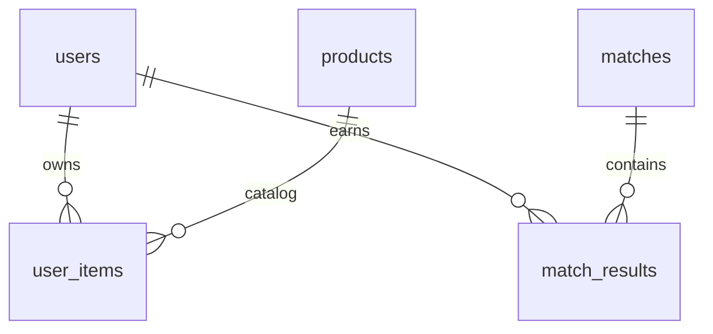

# Lưu trữ cửa hàng và trận đấu

Server mặc định dùng MySQL. Khi khởi động, `DatabaseStore` chạy nâng cấp cộng thêm qua `GameSchema`; không cần xoá volume Docker hay tạo lại database. `docker/mysql/init.sql` cung cấp cùng cấu trúc cho cài đặt mới.

## Quan hệ



- `products`: mã, tên, mô tả, giá, loại (`THEME`/`TITLE`), màu, trạng thái bán và thứ tự hiển thị. Sáu sản phẩm hiện có được thêm nếu thiếu; khởi động lại không ghi đè giá/tên do quản trị viên sửa. Vật phẩm cũ không có trong danh mục được giữ dưới loại `LEGACY`, không bán. Các hiệu ứng hình ảnh vẫn do client hỗ trợ theo mã vật phẩm; thêm mã mới không tự tạo hiệu ứng mới.
- `user_items`: giữ quan hệ người dùng–vật phẩm và thời gian mua. Thêm khóa ngoại tới `products`; vật phẩm đã có người sở hữu nên được ẩn bằng `active=FALSE` thay vì xoá.
- `matches`: UUID mới cho mỗi lần bắt đầu, mã phòng, kích thước bàn, chủ đề, số người, thời gian bắt đầu/kết thúc (epoch milliseconds), trạng thái, lý do và cờ kết thúc bất thường.
- `match_results`: khoá chính `(match_id, username)`, điểm/cặp, thứ hạng, bỏ cuộc, thắng, số trận thắng được cộng, xu thưởng, thay đổi điểm và nội dung lịch sử. `rating_delta` là mức theo luật; `rating_applied` là mức thực tế sau giới hạn điểm không dưới 0.

## Dữ liệu cũ

`match_history` được giữ nguyên làm nguồn lưu trữ cũ. Nâng cấp chép từng dòng sang mã `legacy-<id>` với trạng thái `LEGACY`, giữ nguyên nội dung và thứ tự. Không thể khôi phục mã trận, đối thủ, bàn hoặc chủ đề từ chuỗi lịch sử cũ một cách chắc chắn, nên mỗi dòng cũ được lưu độc lập; các trường cấu trúc chưa biết là NULL. Trận đã lưu ở phiên bản trước nhưng thiếu chủ đề được đánh dấu `UNKNOWN`, không đoán hình ảnh đã dùng. Quá trình nhập không cộng lại thưởng hoặc thống kê. Chạy nâng cấp lại không tạo bản sao trùng.

Nếu nhập tài khoản từ `data/state.bin` vào database trống, tài khoản, vật phẩm và lịch sử được ghi trong cùng transaction. Luồng file dành cho kiểm thử vẫn hoạt động; ba bảng mới áp dụng cho chế độ MySQL.

## Transaction và đồng bộ

Mua hàng khoá hàng tài khoản và đọc giá hiện tại của sản phẩm trong transaction. Trừ xu và thêm quyền sở hữu cùng commit; yêu cầu mua lặp lại không trừ xu lần nữa. Số dư trong database là nguồn quyết định giao dịch.

Khi bắt đầu trận, server ghi `matches` trạng thái `PLAYING` và danh sách người tham gia (kết quả chưa có, các chỉ số NULL) trong một transaction trước khi phát `GAME_START`. Mỗi lượt chơi lại tạo UUID riêng. Nếu lưu thất bại, trận chưa bắt đầu.

Khi kết thúc, server giữ nguyên thuật toán xếp hạng/thưởng cũ và transaction khoá mã trận, ghi toàn bộ kết quả, cập nhật thống kê/ví của người chơi, rồi chuyển sang `COMPLETED`. Yêu cầu lưu lại mã trận đã hoàn thành không thưởng thêm. Client chỉ nhận kết quả và ví sau khi ghi thành công. Lỗi lưu tạm thời được thử lại sau 3 giây khi server vẫn chạy.

Trong chế độ MySQL, `saveState()` không ghi snapshot RAM. Đăng ký/nhập tài khoản chỉ chèn tài khoản chưa có; đổi mật khẩu, avatar và trang bị cập nhật đúng trường của đúng tài khoản. Mật khẩu dùng điều kiện hash cũ; trang bị kiểm tra quyền sở hữu trong database. Snapshot cũ không thể ghi đè ví, thống kê, mật khẩu, avatar, trang bị hoặc khôi phục vật phẩm đã bị thu hồi. Cập nhật giao diện lấy lại số liệu đã commit. Lịch sử đọc từ `matches JOIN match_results` và đọc thêm trực tiếp `match_history` cho các dòng chưa được chuyển đổi, loại trùng theo `legacy_history_id`, tối đa 50 kết quả mới nhất. Trường `recorded_at` và chỉ mục `(username, recorded_at DESC, match_id)` phục vụ lịch sử theo người và thời gian; bảng cũ giữ chỉ mục `(username, played_at DESC)`.

Ván đang chơi được lưu trong `match_snapshots` (phiên bản, checksum SHA-256, số lần ghi và thời gian ghi). Snapshot giữ bàn bí mật, thẻ đã lật/ghép, chủ cặp, điểm, người bỏ cuộc, chat, giai đoạn xử lý và thời gian còn lại. Server ghi trước khi công bố thao tác đã nhận, ghi định kỳ mỗi giây để cập nhật đồng hồ và ghi khi dừng bình thường. Thời gian server ngừng chạy không trừ vào lượt. Chế độ lưu file không hỗ trợ khôi phục ván.

Khi khởi động, server kiểm tra snapshot rồi phục hồi ván ở trạng thái tạm dừng. Người chơi đăng nhập lại để thấy bàn cũ; tất cả người còn tham gia phải bấm **Xác nhận tiếp tục**. Trong lúc chờ, không được lật thẻ/chat và không bị xử bỏ cuộc sau 30 giây mất kết nối. Có thể chủ động rời phòng. Các pha đang chờ úp cặp sai hoặc chờ lượt mới tiếp tục với thời gian còn lại. Thẻ úp luôn bị che trong thông điệp gửi client.

Snapshot thiếu, hỏng hoặc không hợp lệ khiến ván chuyển `INTERRUPTED`, không thưởng. Ván hoàn tất xoá snapshot trong cùng transaction ghi kết quả; mã trận chống cộng thưởng lặp lại. Ván đang tính kết quả được xử lý tiếp sau khi khởi động. Lỗi ghi snapshot khiến ván quay về trạng thái đã lưu gần nhất và tạm dừng. MySQL named lock chặn hai server mới chạy đồng thời trên cùng database; vẫn phải dừng server phiên bản cũ trước khi nâng cấp.

## Ràng buộc dữ liệu

- PK: `products(product_id)`, `matches(match_id)`, `match_results(match_id, username)`, `user_items(username, product_id)`. Mỗi người chỉ có một kết quả mỗi trận và một quyền sở hữu mỗi vật phẩm.
- FK: `user_items → users/products`, `match_results → matches/users`. Không xoá sản phẩm đã có người sở hữu; dùng `active=FALSE`. Người đã sở hữu vẫn nhìn thấy và trang bị được vật phẩm ngừng bán.
- CHECK: giá, xu, rating, thống kê và số cặp không âm; thứ hạng 1–4; cờ boolean chỉ 0/1; bàn 4/6/8, số người 2–4; trạng thái trận chỉ `PLAYING/COMPLETED/INTERRUPTED/LEGACY`; thời gian kết thúc không trước bắt đầu và trận đã kết thúc phải có lý do. Các chỉ số chưa biết của lịch sử cũ/trận bị tắt đột ngột có thể NULL.
- Migration thêm cột/chỉ mục/CHECK còn thiếu và backfill thời gian từ `matches`. Nếu dữ liệu cũ vi phạm CHECK, nâng cấp báo lỗi cụ thể; không tự xoá hoặc ép số âm về 0. DDL MySQL có thể đã áp dụng một phần; chạy lại an toàn sau khi sửa dữ liệu không hợp lệ.

## Áp dụng

1. Kết thúc các trận hiện tại và dừng server cũ.
2. Chạy `sh compile.sh`, khởi động lại server bằng script của dự án.
3. Làm mới Schemas trong MySQL Workbench để thấy `products`, `matches`, `match_results`.

Không chạy đồng thời server cũ với server mới trên cùng database: server cũ vẫn viết lại bảng lịch sử cũ. Nâng cấp đã được kiểm tra trên database tạm riêng; dữ liệu đang dùng không bị chỉnh trực tiếp trong quá trình kiểm thử.

## Kiểm thử

Biên dịch các kiểm thử:

```sh
javac -encoding UTF-8 -cp out -d out test/ProfileTest.java test/HistoryPanelTest.java test/FullGameReplayTest.java test/GamePersistenceProtocolTest.java test/GameDatabaseTest.java test/GameSchemaInitTest.java test/DatabaseFlowsTest.java test/DatabaseIntegrityChecks.java test/PreviousGameSchemaTest.java test/ServerInterruptionTest.java test/GameRecoveryTest.java test/GameCrashRecoveryTest.java
```

Khi Docker MySQL dự án đang chạy:

```sh
java -Djava.awt.headless=true -cp 'out:lib/mysql-connector-j-26.7.0.jar' memorygame.test.DatabaseFlowsTest
java -Djava.awt.headless=true -cp 'out:lib/mysql-connector-j-26.7.0.jar' memorygame.test.DatabaseFlowsTest memorygame.server.GameSchemaInitTest
java -Djava.awt.headless=true -cp 'out:lib/mysql-connector-j-26.7.0.jar' memorygame.test.DatabaseFlowsTest memorygame.test.GamePersistenceProtocolTest
```

Kiểm tra thêm bản schema trung gian và dừng server:

```sh
java -Djava.awt.headless=true -cp 'out:lib/mysql-connector-j-26.7.0.jar' memorygame.test.DatabaseFlowsTest memorygame.server.PreviousGameSchemaTest
java -Djava.awt.headless=true -cp 'out:lib/mysql-connector-j-26.7.0.jar' memorygame.test.DatabaseFlowsTest memorygame.test.ServerInterruptionTest
```

Mỗi lệnh dùng database có tên ngẫu nhiên `game_test_*`, rồi xoá chính database tạm đó. Kiểm tra gồm nâng cấp lặp lại, bảo toàn dữ liệu cũ, SQL cài mới, danh mục động, mua đồng thời, thiếu xu/vật phẩm ẩn, rollback khi chèn lỗi, bắt đầu trận lỗi, chống thưởng trùng kể cả sau khởi động lại, trận hoàn chỉnh, chơi lại, bỏ cuộc, lịch sử và khóa ngoại.

Kiểm thử phục hồi qua nhiều lần khởi động lại (thẻ đầu, cặp sai, cặp đúng, chat, xác nhận, che thẻ, hoàn tất và thưởng):

```sh
java -Djava.awt.headless=true -cp 'out:lib/mysql-connector-j-26.7.0.jar' memorygame.test.DatabaseFlowsTest memorygame.test.GameRecoveryTest
```

Kiểm thử tắt cưỡng bức tiến trình riêng trong phòng ghép nhanh, khoá server trùng và snapshot hỏng:

```sh
java -Djava.awt.headless=true -cp 'out:lib/mysql-connector-j-26.7.0.jar' memorygame.test.DatabaseFlowsTest memorygame.test.GameCrashRecoveryTest
```
